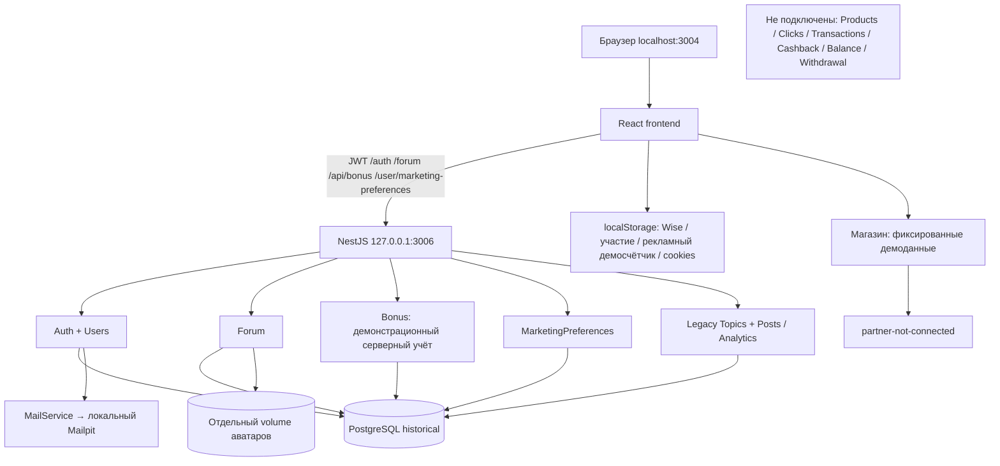
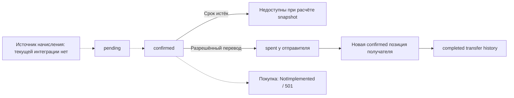

# Аудит бизнес-логики Cashback+

Дата: 20 октября 2026 года. Канонический каталог: `C:\Users\serge\cashback+`.

## A. Вывод для владельца

Текущий Cashback+ — локальное приложение с реальными аккаунтами, подтверждением email, отдельным членством в форуме и сохраняемыми маркетинговыми предпочтениями. Каталог товаров, просмотр рекламы и финансовые показатели частично являются демонстрацией. Полная цепочка «покупка у партнёра → подтверждённая комиссия → доступный cashback → выплата» сейчас **не реализована в активном приложении**. Наличие её отдельных старых сервисов в репозитории этого не меняет.

Обмен демонстрационными бонусами форума использует сервер и PostgreSQL, транзакции и защиту от повторов. Это отдельный учёт, не связанный с браузерными бонусами рекламы, балансом 240 в магазине или полем `users.balance`. Автоматического получения реальных бонусов за покупки/рекламу нет. Форма Wise не является платёжной интеграцией.

**Критический риск:** активный старый `UsersController` содержит незащищённые чтение, создание, изменение пользователей и изменение баланса. Возвращаемые сущности по умолчанию включают хеш пароля и поля email-токена. Это подтверждено исходниками, совпадающими с исходниками активного контейнера; опасные запросы не выполнялись. Есть также отдельные незащищённые legacy-маршруты тем/сообщений. До использования реальных персональных данных или денег эти поверхности необходимо исправить. Loopback-публикация и CORS не заменяют авторизацию.

В этом аудите код, конфигурация и данные не исправлялись. Создан только этот документ. Ниже явно разделены наблюдения текущего запуска, результаты прежних разрешённых тестов и непроверенные возможности.

## Метод и границы доказательств

* **R — текущие read-only наблюдения:** Docker-метаданные, безопасные GET, метаданные PostgreSQL и агрегированные количества в `BEGIN READ ONLY … COMMIT`, исходники и Git. Не читались значения паролей, токенов, телефонов или пользовательские сообщения.
* **S — исходники:** подтверждают реализацию и дефекты, но сами по себе не доказывают успешную бизнес-операцию.
* **E — сохранённые результаты прежних разрешённых E2E:** перечислены ниже. Они не запускались повторно и не подменяются новыми результатами. Совпадение активных исходников/образа проверено там, где указано.
* **U — не проверено:** положительные авторизованные сценарии, браузерная визуальная проверка, внешние партнёры и выплаты не исполнялись в этом read-only аудите.

`WORKING` означает подтверждённую локальную функцию в указанной границе, а не готовность к production. Для процессов, доказанных только кодом, используется `IMPLEMENTED_UNVERIFIED`; для неполных цепочек — `PARTIAL`; для макетов — `DEMO_ONLY`; для отсутствующего активного процесса — `MISSING`; для доказанного дефекта — `BROKEN`.

Тесты/сборки не запускались заново: они могут создавать артефакты, а положительные бизнес-тесты — данные. Использованы существующие отчёты, безопасные runtime-проверки и сравнение исходников. Не выполнялись POST/PATCH/DELETE, вход, регистрация, отправка писем, переводы, выводы, рестарты или миграции.

## B. Фактическая архитектура

### Запуск и идентичности (R)

Git HEAD: `03573b7f47ba3c04dc50312bc71e0a7b904c0ce7`. Рабочее дерево содержит множество восстановленных/адаптированных изменений: это **не неизменённый снимок** этого коммита.

Docker context `desktop-linux`, daemon `ec3d6303-4d66-4410-8317-b739cebc046c`. Текущая общая инвентаризация: **16 контейнеров, 12 сетей, 6 volumes**; прежняя цифра 12 контейнеров не является текущей. Ни один ресурс не изменялся.

Compose project: `cashback-historical-03573b7-local`. Идентификация по полным ID, labels, портам и mounts, не по одному имени:

| Сервис | Полный container ID | Публикация / данные |
|---|---|---|
| Frontend | `3d98e1595ae6cb6600a2460313cf020f154b2ec4c4595fe24b4ff37d66e675da` | `127.0.0.1:3004 → 3000`, running |
| Backend | `b5910499569e8becd7a03408d77a2f2af265f650afc673d8f29eb33cd1db2419` | `127.0.0.1:3006 → 3006`, running |
| PostgreSQL | `48dca500f37c30e2787c9510e8b9111917c19136ea970d036ff43ca4570bec84` | Без host-портов; `cashback-historical-03573b7-local-pgdata` |
| Mailpit | `4f60adf3ecbb3bd57c731e8d4bc25422c08c7843187ab8fad4a08d141fa0d636` | UI `127.0.0.1:8036 → 8025`, SMTP внутренний 1025 |

Образ backend: `sha256:671f4b577d213ed06f2abd052fec289078f980226515fc743b1f49d74c6b8538`; frontend: `sha256:4286e712c805aaf379b674025762f156e87e2a4f75c2bee4188c7bbc1aa9ffb6`.

Для `app.module.ts`, `main.ts`, `auth.service.ts`, `users.controller.ts`, `user.entity.ts`, `bonus.service.ts`, `forum.service.ts`, `marketing-preferences.service.ts` SHA-256 локальных файлов совпал с файлами внутри активного backend. Для всего frontend побайтовое соответствие не устанавливалось.

В [AppModule](../../src/app.module.ts) активны Auth, Users, Forum, Bonus, MarketingPreferences, Analytics, legacy Topics. Mail подключён через auth. Финансовые/торговые модули, перечисленные ниже, не импортированы.

[local-configuration.ts](../../src/local-configuration.ts) фиксирует исторический target и обязательные переменные, `synchronize=false`, `migrationsRun=false`, `installExtensions=false`, `retryAttempts=0`, pool max 3, connection timeout 5 секунд. Production `.env` не загружается. CORS в [main.ts](../../src/main.ts) разрешает `http://localhost:3004`. Общий frontend API — `http://127.0.0.1:3006`.

### База данных (R)

PostgreSQL **17.11**, database **`cashback_historical_03573b7`**, OID **16384**, cluster **7698666936429441062**. Runtime role **`cashback_hist_runtime`**. Метаданные читались владельцем исключительно в read-only транзакции; приложение использует ограниченную runtime-role.

Таблицы public: `users`, `forum_users`, `forum_topics`, `forum_posts`, `bonus_items`, `bonus_transfers`, `marketing_preferences`, `analytics_events`, legacy `topic`, `post`, `historical_schema_baseline`. Все принадлежат `cashback_hist_owner`, не runtime-role. TypeORM-таблица migration history среди них отсутствует; marker `historical_schema_baseline` не равнозначен полному журналу миграций.

Агрегаты: users **3**, email_verified **2**, заполнены все first_name/last_name/phone_e164 **у 1**; forum_users **2**, forum_topics **2**, forum_posts **2**; bonus_items **0**, bonus_transfers **0**, marketing_preferences **0**, analytics_events **0**, legacy topic/post **0**. Происхождение записей не устанавливалось. Нулевые preferences не доказывают неисправность: отсутствие строки означает выключенные optional-каналы; disposable E2E удалял собственные строки.

Runtime-role: SUPERUSER/CREATEDB/CREATEROLE/REPLICATION/BYPASSRLS = false, connection limit роли = **-1** (нет отдельного ограничения роли; pool приложения ограничен тремя). Grants: users SELECT/INSERT/UPDATE; forum_* и legacy topic/post/analytics_events SELECT/INSERT/UPDATE/DELETE; bonus_items SELECT/INSERT/UPDATE; bonus_transfers SELECT/INSERT; marketing_preferences SELECT/INSERT/UPDATE; baseline SELECT. Это не доказательство полного аудита всех inherited/default/PUBLIC DDL-привилегий: такой аудит не завершался.

### Безопасные runtime-запросы (R)

`GET /auth/profile`, `/forum/status`, `/forum/topics`, `/api/bonus/snapshot`, `/user/marketing-preferences` → **401** без JWT. `/forum/rules` → **200 JSON**. `/products`, `/sellers`, `/transactions/user/1`, `/balance/1`, `/withdrawal/1` → **404**. Это подтверждает границы текущей конфигурации, не успешность закрытых операций.

Frontend `/`, `/register`, `/profile`, `/shop`, `/forum`, `/privacy`, `/faq`, `/cookies`, `/terms`, `/bonuses/ads`, `/search?q=retention` → HTML 200; Mailpit UI → 200. SPA shell 200 не подтверждает содержимое экрана, выполнение JS или авторизацию. Inbox в этом аудите не читался.

## Аккаунт, регистрация и права

[AuthService](../../src/auth/auth.service.ts), [UsersService](../../src/users/users.service.ts), [User](../../src/users/user.entity.ts), frontend [Register](../../cashback-frontend/src/pages/Register.tsx), [VerifyEmail](../../cashback-frontend/src/pages/VerifyEmail.tsx), [Profile](../../cashback-frontend/src/pages/Profile.tsx):

* Текущий UI после последующих восстановлений содержит отдельные имя/фамилию и обязательный телефон; это не первоначальная одноимённая форма HEAD. Имя/фамилия 2–100 символов, сохраняются отдельно и формируют совместимое `name`. В базе эти добавленные поля nullable для прежних аккаунтов.
* Email нормализуется; пароль минимум 8, верхний/нижний регистр, цифра, спецсимвол; bcrypt cost 10. Телефон нормализуется в E.164; это **не SMS-подтверждение владения номером**.
* Регистрация `POST /auth/register`, вход `POST /auth/login`, собственный профиль `GET /auth/profile`. JWT живёт 24 часа; секрет обязателен в конфигурации. Роли администратора/продавца и полноценный RBAC отсутствуют.
* Email-токен: криптографические 32 случайных байта, срок 24 часа. Успешное потребление — условный атомарный UPDATE только ещё не подтверждённой записи с действующим сроком, затем обнуление токена/срока. Повторное использование отвергается. Токен в БД не хеширован; особенно важно закрыть его выдачу через legacy Users API.
* Статус в исходной вкладке проверяется сервером; нажатие кнопки само email не подтверждает. Resend имеет cooldown и лимит контроллера (10/час/IP), но это не общий rate limit входа/регистрации. Доставка настроена только в локальный Mailpit, не во внешние почтовые ящики.
* Новые поля first/last/phone имеют `select:false`; password/email_token/expiry по умолчанию выбираются. Собственный auth DTO фильтруется, legacy Users API — нет.
* Проверка существующего email перед INSERT есть, **уникального ограничения/индекса email нет**: pg_indexes для users содержит только users_pkey. Параллельная регистрация может пройти предварительную проверку одновременно. Устранение требует отдельно согласованной миграции после проверки дубликатов, не синхронизации схемы.
* Подтверждение email проверяется в основных forum/bonus сценариях; альтернативные незащищённые Users-маршруты делают общую модель доступа небезопасной. Не считать frontend guards защитой сервера.
* Сброс пароля в текущем AuthController не найден. Безопасность хранения JWT в браузере и полный XSS/CSRF-аудит не доказаны этим обследованием.

### Маркетинговые предпочтения

[Контроллер/сервис](../../src/marketing-preferences/marketing-preferences.service.ts), [Panel](../../cashback-frontend/src/components/MarketingPreferencesPanel.tsx): authenticated GET/POST `/user/marketing-preferences`; субъект только из JWT. Три независимых optional boolean: `specialOffers`, `partnerRecommendations`, `smsMarketing`; defaults false. Mandatory terms и сервисные сообщения отделены. UI доступен в профиле и после регистрации на экране подтверждения email, ссылки ведут к существующим документам.

POST отвергает подмену userId, service-notification и timestamp-полей; частичное изменение сохраняет остальные варианты. Запись выполняется в транзакции с блокировкой пользователя, одна preferences-строка на user. Для нового SMS-согласия требуется телефон; это не доказывает владение телефоном. Сохраняются SMS grant/revoke timestamps/version; повторное разрешение без изменения не переписывает дату. Общие created/updated timestamps не являются полной append-only историей всех согласий. Отзыв меняет действующие флаги. Маркетинговый sender/campaign pipeline не найден, поэтому фактическое соблюдение flags внешним отправителем не проверено.

## C. Покупка → cashback: полный разбор

| Шаг | Экран / endpoint / сервис / таблица | Правило и фактический статус |
|---|---|---|
| Покупатель | `/register`, `/profile`; `/auth/*`; Auth/Users; users | Реальный локальный аккаунт, см. ограничения безопасности выше |
| Товар | `/shop`, ProductOffers; неактивный ProductsController `/products` | 100 seeded товаров/предложений, mock sellers; активной product-таблицы нет. DEMO_ONLY |
| Партнёр | Shop → `/partner-not-connected`; неактивные Partners/Sellers | Реального подключения/онбординга/одобрения партнёров нет. PARTIAL/MISSING |
| Переход | Неактивный `POST /clicks`, ClicksService, Click | Модель click хранит offer/seller/time, без привязки пользователя/подписанного внешнего tracking ID. Нет активной таблицы/redirect. MISSING в runtime |
| Покупка | Неактивный TransactionsService, transaction | createTransaction принимает amount/user/click, но нет принятого merchant order, webhook или подтверждения продавцом. MISSING |
| Подтверждение | Нет активного endpoint/service/state machine | Некому и нечем подтвердить оплату, отмену или возврат. MISSING |
| Комиссия | Локальные rates/формулы в предложениях | Нет реестра комиссии, сверки провайдера и settlement. MISSING |
| Начисление cashback | Неактивный CashbackService, отдельная Transaction entity | Прямое сложение users.balance и отдельная запись истории; не подключено. PARTIAL, небезопасно включать как есть |
| Доступный баланс | users.balance / неактивные Balance/Withdrawal | Нет связанного пути от подтверждённого заказа до доступных средств. MISSING |

[Shop.tsx](../../cashback-frontend/src/pages/Shop.tsx:45) задаёт `USER_BONUS_BALANCE = 240` и фиксированный bonus pool, локальный выбор позиций/сортировку/расчёт. `onBuyClick` после auth/email-проверок ведёт на `partner-not-connected`, не создаёт заказ/клик и не списывает бонусы. [ProductOffers](../../cashback-frontend/src/pages/ProductOffers.tsx) — seeded цены/скидки/cashback, не выгрузка партнёра.

Неактивные источники: `src/products`, `src/partners`, `src/sellers`, `src/clicks`, `src/transactions`, `src/cashback`, `src/price-calculation`. Нет активного seller signup/approval workflow; boolean deactivation в старом сервисе не является модерацией партнёров. Partners и Sellers содержат параллельные модели/контроллеры `/sellers` — нельзя просто подключить оба.

Важные дефекты до любого восстановления:

1. `src/transactions/transaction.entity.ts` и `src/cashback/transaction.entity.ts` описывают разные сущности с тем же обычным именем таблицы transaction: несовместимые поля/назначение.
2. CashbackService меняет баланс и сохраняет историю раздельно, без общего transaction/idempotency/provider-order uniqueness, без полноценного контроля положительной суммы/возврата.
3. PriceCalculationService умножает price на `cashback_rate_percent` без `/100`; frontend считает проценты иначе. Единица seller discount тоже неоднозначна. Это исходниковый дефект неактивной реализации, не доказанный текущий финансовый ущерб.
4. Нет текущего правила, когда cashback переходит pending→available; нет сверки commission received, handling cancellations/refunds/chargebacks. Реальную доходность и комиссии сейчас подтвердить невозможно.

## D. Бонусы: жизненный цикл и раздельные балансы

| Источник/баланс | Где живёт | Связь и ограничения |
|---|---|---|
| Forum demo credits | PostgreSQL bonus_items/bonus_transfers | Серверный отдельный учёт; сейчас обе таблицы пусты; нет публичного автоматического mint за покупки/просмотры |
| Рекламная демонстрация | localStorage `cashback_demo_ads_daily:<id>` + React session state | 1/2/3 бонуса за анимацию, не отправляются в серверный ledger |
| Магазин | Константа 240 и buildBonusPool в Shop | Не отражает ни users.balance, ни bonus_items |
| Dashboard | Seeded рекламная/финансовая история | Демоданные, не подтверждение дохода или выполненных выплат |
| users.balance | Поле users, legacy сервисы | Не синхронизировано с bonus_items; незащищённый endpoint изменения — критический риск |
| Старый standalone bonus-api | Исторический Express/SQLite сервис | Сейчас не используется; его данные/порт не являются активным источником Nest ledger |

[BonusService](../../src/bonus/bonus.service.ts) обслуживает `/api/bonus/*`. Snapshot требует подтверждённого основного аккаунта, но сам по себе не требует forum membership. Доступные позиции — confirmed, не использованные, не истёкшие; pending/expired/spent выделяются отдельно. Денежные значения проверяются через целочисленные cents, а не свободное сложение float.

Превращение источника в pending/confirmed не реализовано как сквозной бизнес-процесс. Есть метод expireOldBonuses, но расписание его запуска не установлено; snapshot всё равно исключает истёкшие позиции по времени.

Перевод: валидный forum username, разные user ID, оба необходимых аккаунта/членства/ban-проверки, 1–100 уникальных credit IDs, Idempotency-Key, request hash, блокировки и единая DB transaction. Переносятся **целые позиции**, срок сохраняется. Исходная позиция помечается spent, получателю создаётся confirmed, история completed. UNIQUE sourceBonusId препятствует повторному расходованию; повтор того же ключа/запроса возвращает прежний результат, изменение запроса конфликтует. Порядок IDs участвует в hash: перестановка того же набора не равна прежнему запросу.

Глобальный advisory lock `(726401,1)` сериализует переводы: полезен для целостности демо, ограничивает масштабирование. История snapshot ограничена последними 100 переводами, не полноценный финансовый statement. Неактивный `src/bonus-transfer` использует другой баланс и раздельные операции sender/recipient: его нельзя включать вместо активного транзакционного сервиса.

Серверный demo exchange ранее проверен реальными disposable fixtures (E), но покупок, внешних денег или redeemability он не доказывает. Смешивать перечисленные балансы без утверждённой модели/миграции нельзя.

## E. Форум

Основной User → максимум один ForumUser через unique user_id; forum username отделён от покупательского имени. В БД есть UNIQUE username и **UNIQUE lower(username)**, подтверждённые pg_indexes. Правила принимаются явно, дата ставится сервером, автоматического enrollment при основном signup нет.

Маршруты [ForumController](../../src/forum/forum.controller.ts): `POST /forum/register`, `GET /forum/status`, public `GET /forum/rules`, public sanitized `/forum/user/:username`, `PATCH /forum/profile`, `POST /forum/avatar`; темы/сообщения `/forum/topics`, `/forum/topic/:id`, `/forum/posts/:topicId`, `/forum/post`, удаление собственной темы. Точные DTO/verb — в контроллере; этот перечень не инструкция для mutation-тестов.

Чтение тем разрешено подтверждённому основному аккаунту без обязательного членства; запись требует membership и отсутствия ban. Заблокированный участник не может писать/переводить, чтение остаётся доступно в предусмотренных guards. Авторство отображается forum username, не email/имя покупателя. Public profile фильтрует персональные данные.

Аватар PNG/JPEG/WebP ≤500KB, проверка сигнатуры, имя контролируется сервером, отдельный volume, static nosniff. E содержит проверку загрузки и отказ поддельному PNG. Модерация неполная: ban-проверки есть, полноценный активный administrative/reporting workflow не подключён. Удаление темы/постов выполнено несколькими операциями без общей транзакции — риск частичного удаления/гонки.

**Отдельная legacy-поверхность:** активный TopicsModule включает `/topics` и `/posts` без guards, с отдельными таблицами `topic`/`post`. Это не те же таблицы, что forum_topics/forum_posts, поэтому нельзя утверждать прямой обход membership именно современного форума. Но самостоятельные открытые mutation endpoints и двойная модель форума — подтверждённый дефект безопасности/архитектуры.

## F. Реклама и «3 бонуса»

[BonusAds.tsx](../../cashback-frontend/src/pages/BonusAds.tsx) прямо сообщает, что это demo animation, не видео, и реальный баланс не меняется. В текущем и проверенном прежнем варианте нет настоящего video player/MP4/WebM/ad provider. Используются фон, `Coin.png`, CSS и requestAnimationFrame.

Правило: случайная награда **1, 2 или 3 бонуса начисляется в локальный счётчик после пяти секунд видимой анимации**; это не списание трёх бонусов. Согласие запускает просмотр; hidden-пауза, прекращение без завершения не награждается, ref предотвращает повтор внутри одного запуска. При refresh награда автоматически не повторяется, дневное значение хранится в localStorage. Это не серверная защита от накрутки/нескольких вкладок/изменения localStorage.

Требуются auth/email и локальные onboarding flags, но это не серверное финансовое право. Ошибка assets не является backend-рекламной интеграцией. Реальный выбор/воспроизведение видео, подтверждение досмотра провайдером, серверное начисление и связанный ledger **MISSING**. Историческая анимация — **DEMO_ONLY**, не неисправный реальный видеосервис.

## G. Wise и вывод

`cashback-frontend/src/onboarding.ts`, Profile и WiseAccountNotice используют localStorage `cashback_wise_data:<id>` / `cashback_program_enrolled:<id>`. Это браузерные данные формы и локальное участие, не server-side KYC/eligibility/подтверждённый банковский получатель. Notice свёрнут по умолчанию через details; ссылки на Wise не создают payout-интеграцию.

В активной БД нет withdrawal/balance_operations/onboarding_recipients/programme_memberships. Активных `/withdrawal` и `/balance` нет. Нет действующего минимума вывода, резервирования, платёжного processor, transaction ID провайдера, подтверждения paid или reconciliation. Dashboard-история не является выпиской.

Неактивный нынешний WithdrawalService нельзя включать: проверяет только balance<amount, не задаёт полноценный positive/minimum rule; списание/создание/уведомление не в одной транзакции; approve меняет строковый статус без платежа; reject не защищён от повторного возврата и обращается к незагруженной user relation. BalanceService также раздельно сохраняет операцию, баланс и notification. Эти дефекты подтверждены исходниками, финансовые вызовы не исполнялись.

Сильнее реализованный исторический ручной GBP reservation найден отдельно в `4e64a37` (см. I): его правило £10 **не действует сейчас** и не означает интеграцию с Wise.

## Политики, cookies и согласия

Privacy, FAQ, Cookies, Terms имеют компоненты/маршруты и footer links; shell отдаётся при refresh. Содержимое документов не равно доказательству исполнения всех обещаний: например, формулировки о шифровании/PCI/аудитах нужно сверить с фактическим bcrypt и отсутствием реального payment pipeline. Юридическая пригодность и соответствие законодательству этим техническим аудитом не устанавливаются.

Cookie banner хранит `cookiesAccepted` (all/decline/necessary), category modal — **другой** ключ `cashback_cookie_settings` (necessary/analytics/functional/marketing). All/Decline не синхронизируют category key; modal JSON.parse не защищён от некорректного сохранённого JSON. После закрытия banner постоянный путь повторного открытия не подтверждён. Связь choices с реальным разрешением/блокировкой processors не найдена; отдельная неиспользуемая Analytics page обращается к старому localhost:3000, а не действующей конфигурации. Не заявлять, что необязательный tracking реально заблокирован.

Mandatory terms checkbox существует на frontend, но серверная запись version/timestamp принятия и обязательная проверка согласия в register DTO не обнаружены. Forum rules boolean/date сохраняются, immutable версия текста не связана с каждой записью. Marketing SMS имеет последние consent/revoke/version, не полную историю; email-маркетинг — действующие флаги и общие timestamps. Cookie marketing, маркетинговые каналы, сервисные уведомления и forum rules — разные согласия, их нельзя отождествлять.

## H. Статусы функций и доказательства

| Функция | Статус | Основание / ограничение |
|---|---|---|
| Исторический локальный стек | WORKING | R: контейнеры, identity DB, ответы; не утверждение о production |
| Регистрация/имя/фамилия/телефон | IMPLEMENTED_UNVERIFIED | S + прежний EXTENDED E2E; в текущем аудите positive signup запрещён |
| Password ≥8 и complexity | IMPLEMENTED_UNVERIFIED | S; PASSWORD-HINT-RESULT, не новый runtime-тест |
| Email confirmation/status/resend | IMPLEMENTED_UNVERIFIED | S + EMAIL/EXTENDED E; новая доставка/переход не исполнялись |
| Local SMTP/Mailpit UI | PARTIAL | UI running; внешняя доставка отсутствует, новая локальная не проверялась |
| Login/own profile | IMPLEMENTED_UNVERIFIED | Guard 401 R, positive flow E; визуально сейчас не проверено |
| SMS verification / reset password / RBAC | MISSING | Нет активных workflows |
| Marketing preference persistence/withdrawal | WORKING | MARKETING_RUNTIME_PASS на том же backend image + текущая таблица/guards/source; sender enforcement U |
| Защита legacy Users API | BROKEN | S: guards/DTO отсутствуют, raw entities; matching container source; без эксплуатации |
| Unique email / race protection | BROKEN | R: только users_pkey; S: check-before-insert |
| Partner/seller signup/approval | MISSING | Не подключены модули/таблицы, нет активного workflow |
| Каталог/сравнение/цены | DEMO_ONLY | S: seeded товары, локальные формулы, balance240 |
| Tracking/order/commission/cashback | MISSING | 404 + отсутствующие таблицы/активные сервисы |
| Серверный forum bonus exchange | DEMO_ONLY | Транзакционный DB учёт, прежний FORUM-DEMO E; нет внешнего источника/денег |
| Покупка за бонусы | MISSING | spendBonusesOnPurchase → NotImplemented |
| Bonus expiry scheduler | IMPLEMENTED_UNVERIFIED | Метод есть, расписание не установлено; snapshot time check есть |
| Рекламная анимация/награда | DEMO_ONLY | S + ADS-RESULT; browser local counter, не видео |
| Реальное video reward processing | MISSING | Нет media/provider/server accrual |
| Отдельная регистрация форума/аватар/topics/posts | IMPLEMENTED_UNVERIFIED | FORUM-DEMO E + R schema/source/401; текущий positive/read UX не исполнялся |
| Модерация | PARTIAL | Ban enforcement есть, полный management/report flow не активен |
| Legacy topics/posts authorization | BROKEN | S: активные unguarded endpoints, отдельные таблицы |
| Wise реквизиты/участие | DEMO_ONLY | localStorage, не подтверждённый server recipient |
| Вывод/paid confirmation | MISSING | Нет активных таблиц/маршрутов/provider |
| Финансовая история Dashboard | DEMO_ONLY | Seeded frontend data |
| Privacy/FAQ/Cookies/Terms страницы | IMPLEMENTED_UNVERIFIED | Компоненты/links/предыдущий FOOTER report; shell200 недостаточен для visual WORKING |
| Cookie consent enforcement | PARTIAL | Два disconnected storage keys, processor wiring не доказано |
| Terms/rules consent audit trail | PARTIAL | Terms server proof нет; rules date без immutable version |
| Header search | IMPLEMENTED_UNVERIFIED | SEARCH report: index15 pages; shell GET, текущий browser search не выполнялся |

Сохранённые отчёты: [FORUM-DEMO-RESULT](FORUM-DEMO-RESULT.json) (103 backend/66 frontend tests, disposable API/DB E2E, username/avatar/transfer/idempotency/cleanup); [EXTENDED-RESULT](EXTENDED-RESULT.json) (117 backend/98 frontend, fields/email/profile); [MARKETING-WISE-RESULT](MARKETING-WISE-RESULT.json) (125 backend/109 frontend, grant/partial-update/relogin/revoke/SMS dates/isolation, cleanup); [ADS-RESULT](ADS-RESULT.json) (88 tests); [SEARCH-RESULT](SEARCH-RESULT.json) (80 tests, 15 pages); [PASSWORD-HINT-RESULT](PASSWORD-HINT-RESULT.json) (117 backend/101 frontend). Счётчики относятся к разным запускам/ревизиям, **не суммируются** и не являются результатом этого аудита. Disposable fixtures тех запусков были удалены; в аудите они не создавались.

## I. Исторические функции и безопасный потенциал восстановления

| Git-источник | Что действительно найдено | Отличие от активного приложения / условия |
|---|---|---|
| `03573b7…` | Исторические Auth/Users/Topics/Forum/Analytics | Базовый HEAD; текущие selective changes уже расширили его. Не полноценный cashback backend |
| `d14f76e9d8cd52de3aeffb3c6dc78c6639e1b28f` | Auth/Forum/Bonus/Marketing, search/policies/demo; AppModule без торгово-финансовой цепочки | Референс не доказывает, что реальные покупки/вывод когда-либо работали |
| `92c8532` | users.dto, JWT owner-only UsersController; удалены public list/create/balance; HTTP decorators legacy topics/posts сняты | Текущий UsersController и legacy handlers этих защит не содержат. Восстановление требует review зависимостей и negative tests, не cherry-pick вслепую |
| `4e64a37` | OnboardingModule, encrypted recipients AES-256-GCM + AAD userId, programme_memberships с версиями/датами; integer pence; manual GBP withdrawals с minimum £10, UUID requestId, lock, idempotency, reservation transaction | Сейчас этих таблиц/модуля нет; нынешний WithdrawalService другой. Нужны reviewed migrations/key lifecycle и сверка учёта. Это ручное резервирование, не Wise payout |
| d14 standalone `cashback-frontend/bonus-api/server.mjs` | Express + SQLite, отдельный порт/upstream auth | Сейчас не активен; старые SQLite файлы не читались. Не восстанавливать второй backend вместо текущего Nest ledger |

`git merge-base --is-ancestor` для 4e64a37 и 92c8532 относительно текущего HEAD вернул false. Дата 4e64a37 (6 октября) раньше baseline по календарю, но он не предок HEAD: даты/сообщения коммитов не доказывают граф наследования или runtime-готовность. Исторические security/withdrawal реализации принадлежат отличающимся линиям, совместимость не установлена.

## J. Риски и целостность

1. **Критический — персональные данные/аккаунты/баланс:** [UsersController](../../src/users/users.controller.ts:4), [UsersService](../../src/users/users.service.ts:17), [User](../../src/users/user.entity.ts:27). Без guards, allowlist DTO и safe serialization. Возможны раскрытие хешей/активных email tokens и несанкционированное изменение account state. Не проверялось опасным HTTP. Исправление необходимо раньше запуска реальных финансовых функций.
2. **Высокий — email uniqueness:** R/S доказанный race window; сначала read-only duplicate inventory и решение по существующим данным, затем отдельно разрешённая unique migration. Не удалять/сливать аккаунты автоматически.
3. **Высокий — двойные legacy endpoints:** topics/posts открыты независимо от современного форума; убрать/закрыть старую HTTP поверхность, сохранив современные routes и данные.
4. **Высокий — непригодность старых finance stubs:** неатомарные debit/credit/history, отсутствие idempotency/paid proof и конфликт Transaction entities. Простое включение модулей опасно.
5. **Высокий — недостоверная демонстрационная экономика:** несколько несвязанных балансов, mock доходность/история, local flags. Нельзя предъявлять их как доступные реальные средства.
6. **Средний — forum deletion и глобальная блокировка transfers:** отсутствие transaction у удаления; serial transfer lock ограничивает concurrency. Нужны race tests, не снятие блокировок ради скорости.
7. **Средний — неполный consent trail и cookie enforcement:** сроки/версии/processor gating не покрыты сквозным процессом. Не выдавать юридический текст за техническую гарантию.
8. **Средний — ограниченные operational controls:** роль без role-level connlimit, общий auth abuse protection не доказан; полный privilege/backup/restore/security audit вне этой проверки. Наличие backup-файла не доказывает восстановление.

## K. Приоритетный план восстановления — без выполнения

До P1 — обязательный security gate: закрыть legacy Users/Topics/Posts. Есть исторические safe DTO/owner checks в 92c8532; отсутствует их текущая интеграция. Изменить только controllers/DTO/serialization и добавить negative authorization tests; dependencies JWT strategy и актуальные profile consumers. Схема для закрытия endpoint не нужна. Риск сломать legacy consumers — инвентаризировать их; проверять register/email/own profile/forum. Это отдельное изменение с разрешённым build/deploy, не часть аудита.

| Приоритет / изменение | Уже есть → чего нет / что изменить | Зависимости и миграции | Риски и изоляция |
|---|---|---|---|
| **P1.1 Реальный каталог и partner onboarding** | Demo UI и старые repo services → утверждённая единая seller/product/offer модель, approval, разрешённые partner URLs | Partner contract/feed, roles; новые reviewed tables/indexes/FKs, выбор одной Seller модели | Не включать оба `/sellers`; feature-gate реальные офферы, сохранить public pages/auth/forum; миграции отдельно разрешить |
| **P1.2 Click → order → confirmation** | Старый Click/Transactions skeleton → user-bound opaque tracking ID, подписанный webhook, merchant-order uniqueness, состояния и refund/cancel processing | Контракт провайдера/подписи/секреты, каталог; новые click/order/event constraints | Нет реального провайдера — runtime BLOCKED; idempotent ingress, replay tests; не направлять demo Buy в деньги |
| **P1.3 Commission → cashback ledger** | Формулы UI и неактивный addCashback → согласованные единицы %, pence, pending/confirmed/available/reversed, атомарная history+balance projection | P1.2, правила комиссии/сроков/валют; reconcile Transaction entities; ledger/event uniqueness migrations | Двойное начисление/возвраты; incremental event pipeline отдельно от auth/forum, никаких автоматических conversion старых demo balances |
| **P1.4 Email identity integrity** | Предварительная проверка email → DB uniqueness после разрешённого duplicate review | Read-only анализ существующих email + решение владельца; unique normalized index migration | Не потерять пользователей; additive migration/rollback plan отдельно, не synchronize |
| **P2.1 Единая спецификация бонусов** | Рабочий demo ledger + независимые shop/ads counters → документировать redeemability/источники/валюты, оставить demo маркировку, утвердить конверсию либо отсутствие связи | Бизнес-правила; при реальном accrual новые source-event IDs/constraints | Нельзя переносить 240/localStorage в деньги. Сохранить forum exchange API, не сбрасывать balances |
| **P2.2 Источники/расход/истечение** | Transactional transfer + expiry check → idempotent accrual от проверенных P1 events, spending transaction, bounded expiry job, полная пагинируемая история | P1 или иной утверждённый источник; schema для provenance/unique event/spend records | Double spend/expiration races; additive opt-in integration, E2E disposable fixtures отдельно разрешить |
| **P2.3 Производительность/целостность обмена** | Locks/idempotency уже есть → нагрузочные/race tests, canonicalized ID set, атомарное topic deletion | Тестовая изоляция, текущие API; schema не обязательно, indexes после измерений | Не ослаблять guards/locks. Сохранить ban/self/expiry/duplicate rejection; менять независимо от регистрации |
| **P3.1 Server onboarding и получатель** | Local Wise form + исторический 4e64a37 → reviewed server eligibility, encrypted recipient, versioned consents/key lifecycle | Юридические/платёжные требования; onboarding_recipients/programme_memberships и keys без публикации | Чувствительные реквизиты, key loss; не импортировать localStorage автоматически, не менять маркетинг/профиль без согласования |
| **P3.2 Резервирование и контроль вывода** | Исторические integer-pence/£10/requestId/locks → адаптировать к утверждённому available ledger, роли approval, строгие статусы/release exactly-once | P1 ledger/P3.1, бизнес minimum/currency; withdrawal/reservation/operation constraints | Исторические £10 не принимать как текущее решение владельца; shadow/read-only сначала, auth/forum не затрагивать |
| **P3.3 Исполнение/сверка платежа** | Только ссылки Wise → утверждённый manual settlement либо provider integration, signed status/payment ID, reconciliation/audit | Платёжный договор, secrets, роль оператора; уникальные payout IDs и immutable events | Реальные деньги требуют отдельной авторизации; не считать approve=paid; запрет автоматического destructive rollback |
| **P4.1 Cookies/consent/documents** | Pages/checkboxes/SMS timestamps → единый cookie state, доступный reopen, processor gating, terms/rules versions, полный consent history при необходимости | Privacy review; migrations только для согласованного append-only consent trail | Не смешивать service/marketing/forum scopes; сохранять текущие opt-outs, не включать defaults |
| **P4.2 Модерация и recovery UX** | Ban enforcement, auth flow → admin/report workflow, безопасный reset password, abuse controls | RBAC/security gate, mail local vs external config; token/audit storage по проекту | Не менять действующие email token semantics без regression tests; локальные письма не объявлять внешней доставкой |
| **P4.3 Реальная video advertising** | Анимация → только при наличии разрешённых media/provider: player и серверный completion event | Media rights/provider contract, P2 accounting, anti-abuse; event schema вероятно нужна | Не обещать reward за клиентский timer; demo оставить отделённым; текущий форум/почту не трогать |
| **P4.4 Public UX/search/accessibility** | Restored search/index/policies → browser mobile/desktop/link/refresh verification, remove misleading finance claims | Browser read-only checks, translations; DB migrations не нужны | Независимо от backend/финансов, сохранить navigation и consent controls |

Каждая строка — отдельная оценка и последующее разрешённое изменение, не команда к миграции/восстановлению. Никакие старые модули нельзя массово импортировать для «включения всех функций».

## Непроверенные области и причина

* Новый signup/login/email/resend/transfer/withdrawal не запускались: запрет на mutation и письма. Предыдущие E2E явно отделены от текущих R.
* Визуальные desktop/mobile browser flows, CAPTCHA/доступность, current search results, profile redirects не проверялись браузером. SPA HTTP200 этого не доказывает.
* Реальные seller feeds, покупки, commission callbacks, внешние SMTP/SMS/Wise payments не настроены/не подтверждены; активных интегрированных процессов нет.
* Полный анализ всех PostgreSQL inherited/default/PUBLIC permissions, capacity under load, backup restore и recovery не проводился. Metadata owner/role flags/grants не равны полному security certification.
* Win32_Service read-only inspection PostgreSQL-служб вернул **Access denied**. Доступ не обходился, elevation не запрашивалась; статус защищённого PostgreSQL16 этим способом не установлен. Историческая Docker DB идентифицирована независимо.
* Происхождение трёх существующих пользователей, содержимое их профилей/форумных записей, SQLite backups и секреты не исследовались. Данные не нужны для доказательства схемы/маршрутов и не раскрывались.
* Исторические ветки inspected source-only; их сборка, migration compatibility и работоспособность не проверялись и не заявляются.

## Итог

**BUSINESS_LOGIC_AUDIT_COMPLETE** — обследование завершено в разрешённой read-only границе с перечисленными ограничениями. Реальные cashback/вывод отсутствуют как сквозные процессы; demo balances разделены; обнаружены подтверждённые security blockers. Единственное изменение этого задания — данный Markdown-отчёт. Сервисы, исходники приложения, база, аккаунты, Docker-ресурсы и настройки не изменялись.
